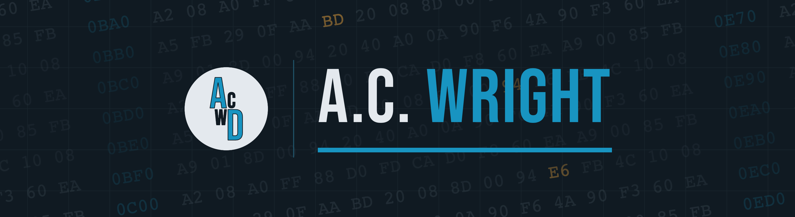

# A.C. Wright

Software developer of 20+ years. These days I design, build and program 8-bit computers.

The project I'm currently working on is the **AC6502**, a family of homebrew 6502 computers.
The rest of this account is a mix of retro computing, Swift and SwiftUI examples, and
other projects.

## The AC6502

The AC6502 family is five computers built around the 65C02. Every machine is
open source, including the schematics, Gerbers, bills of materials and firmware, so you
have everything you need to build your own. If you would rather not build one, the
[emulator](https://acwright.github.io/6502-EMULATOR/) runs the whole family in your
browser. The [user's and programmer's guide](https://acwright.github.io/6502-DOCS/)
explains how to use and program each machine.

### The AC6502 Machines

| | |
|---|---|
| [6502-ACE](https://github.com/acwright/6502-ACE) | **A**ll-in-one **C**omputer **E**xperience — the whole family on a single board: 65C02, VGA video, SID audio, storage, serial, GPIO and a real-time clock |
| [6502-KIM](https://github.com/acwright/6502-KIM) | **K**eypad **I**nput **M**onitor — a 65C02, a 24-key pad, a 16×2 LCD and eight LEDs. Boots into a hex monitor |
| [6502-DEV](https://github.com/acwright/6502-DEV) | **D**evelopment **E**nvironment **V**ehicle — a Teensy 4.1 stands in for the CPU, with run/stop, single-step and a clock you can slow to a crawl |
| [6502-COB](https://github.com/acwright/6502-COB) | **C**omputer **o**n a **B**ackplane — the modular desktop: card slots, up to 544KB of RAM, and a card for every peripheral |
| [6502-VCS](https://github.com/acwright/6502-VCS) | **V**ideo **C**omputer **S**ystem — the console of the family: ROM cartridges, VGA out, SID sound and 2600-compatible joysticks |

### AC6502 Firmware, Emulators & Tools

| | |
|---|---|
| [6502-DOCS](https://github.com/acwright/6502-DOCS) | The user's and programmer's guide for the AC6502 family |
| [6502-BIOS](https://github.com/acwright/6502-BIOS) | The 32KB ROM every machine boots: the Kernal, the Monitor and BASIC. It probes the I/O slots, so missing cards are simply skipped |
| [6502-EMULATOR](https://github.com/acwright/6502-EMULATOR) | The family, emulated — cycle-accurate 65C02, TMS9918 video, SID audio. Browser or desktop |
| [6502-KIMULATOR](https://github.com/acwright/6502-KIMULATOR) | The KIM in particular — pad, LCD and the eight LEDs on the bus. Browser or desktop |
| [6502-PICOCALC](https://github.com/acwright/6502-PICOCALC) | The whole machine as one `.uf2` for the ClockworkPi PicoCalc — a handheld AC6502 |
| [6502-ASM](https://github.com/acwright/6502-ASM) | Assembly programs for the family, each with a Makefile |
| [6502-PRG](https://github.com/acwright/6502-PRG) / [6502-CRT](https://github.com/acwright/6502-CRT) | Templates to start from — a program that loads into RAM, or a cartridge that overlays ROM |
| [bin2woz](https://github.com/acwright/bin2woz) | Binary → WozMon deposits, to paste into a machine over a serial terminal |
| [cffs](https://github.com/acwright/cffs) | Build and edit CompactFlash images from the command line — up to 256 disk banks |
| [VT-AC](https://github.com/acwright/VT-AC) | A VT terminal that could have existed but didn't — VT-100 compatible, with 256 colours and a graphics mode. Desktop, web and CLI |
| [TMS9918-EDITOR](https://github.com/acwright/TMS9918-EDITOR) | Character and screen editor for the TMS9918 VDP |

## Retro Computing

| | |
|---|---|
| [APL1](https://github.com/acwright/APL1) | A homebrew Apple 1 replica — 6502, 65C21 PIA and WozMon, with a microcontroller terminal adding PS/2 and serial |
| [WIZARDSLAB](https://github.com/acwright/WIZARDSLAB) | A falling-block match-three game for the AC6502, the Commodore VIC-20 and the Commodore 64 |
| [KEY2USB](https://github.com/acwright/KEY2USB) | A Commodore 64 / C128 expansion port cartridge to USB HID keyboard |
| [VIC-20](https://github.com/acwright/VIC-20) / [APPLE-I](https://github.com/acwright/APPLE-I) | Assembly language programs for the VIC-20 and the Apple I |
| [VIC-EDITOR](https://github.com/acwright/VIC-EDITOR) | Character and screen editor for the VIC-20 |
| [Chip8Kit](https://github.com/acwright/Chip8Kit) | A Swift package for interpreting CHIP-8 ROMs |
| [PICO-8](https://github.com/acwright/PICO-8) | My PICO-8 games and demos |

## Swift & SwiftUI

| | |
|---|---|
| [SwiftUIMenuBar](https://github.com/acwright/SwiftUIMenuBar) | A tutorial for creating a menu bar application in SwiftUI |
| [ImportExport](https://github.com/acwright/ImportExport) | Importing and exporting files with SwiftUI |
| [DocExample](https://github.com/acwright/DocExample) | Using ReferenceFileDocument in SwiftUI |
| [StoryboardBindingsExample](https://github.com/acwright/StoryboardBindingsExample) | Binding data across multiple scenes in macOS storyboards |

## Contact & Elsewhere

- 📍 Lincoln, Nebraska
- ✉️ Email — [acwrightdesign@gmail.com](mailto:acwrightdesign@gmail.com)
- 📺 YouTube — [@acwrightdesign](https://www.youtube.com/@acwrightdesign)
- 🎮 itch.io — [acwrightdesign.itch.io](https://acwrightdesign.itch.io)
- 📷 Instagram — [@acwrightdesign](https://instagram.com/acwrightdesign)
- 📌 Pinterest — [acwrightdesign](https://pinterest.com/acwrightdesign)
- ✍️ Medium — [@acwrightdesign](https://medium.com/@acwrightdesign)

## Tools of the Trade

